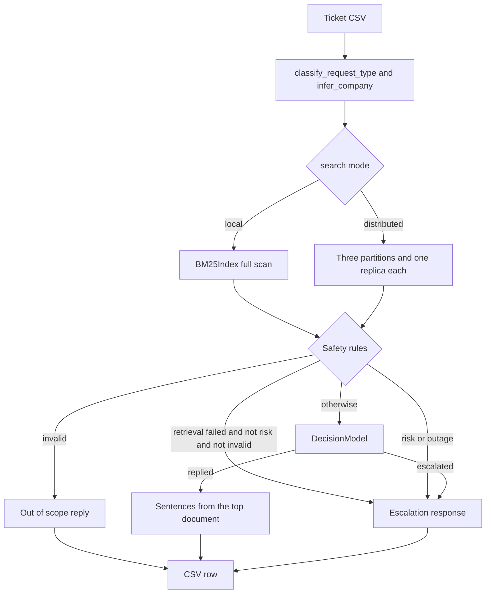

# Multi-domain support triage

This program reads a support ticket and either replies with sentences from local help documents or escalates the ticket to a person. It covers HackerRank, Claude, and Visa. It fails closed: `decision_cost` in `code/prediction/model.py` charges 5 for a wrong reply and 1 for an unnecessary escalation, and distributed search raises `RetrievalUnavailable` instead of answering from a partial index (`docs/adr/004-fail-closed.md`).

The system runs on one machine. The measured corpus is 7,957 chunks (`support_tickets/distributed_report.json`, field `corpus_documents`). Distributed mode uses 3 partitions, with 1 replica each (`code/config/shards.local.json`).

## Contents

1. [Highlights](#highlights)
2. [Architecture](#architecture)
3. [Quick start](#quick-start)
4. [Problem statement](#problem-statement)
5. [Pipeline](#pipeline)
6. [Retrieval](#retrieval)
7. [Prediction model](#prediction-model)
8. [Evaluation](#evaluation)
9. [Distributed index and storage](#distributed-index-and-storage)
10. [Fault tolerance](#fault-tolerance)
11. [Design decisions](#design-decisions)
12. [Complexity](#complexity)
13. [Testing](#testing)
14. [Metrics](#metrics)
15. [Benchmark environment](#benchmark-environment)
16. [Tech stack](#tech-stack)
17. [Project history](#project-history)
18. [Limitations and future work](#limitations-and-future-work)
19. [Project fact sheet](#project-fact-sheet)
20. [Claims and evidence](#claims-and-evidence)
21. [Skills and keyword map](#skills-and-keyword-map)
22. [Resume bullets](#resume-bullets)
23. [Short descriptions](#short-descriptions)
24. [Interview preparation](#interview-preparation)

## Highlights

- On the frozen 29 tickets, the pipeline replies to 9 and escalates 20. There is 1 wrong reply and 0 unnecessary escalations. Reply precision is 8/9, stored as `0.8888888888888888`. Escalation precision is `1.0`. The 5-to-1 cost is 5 (`support_tickets/decision_report.json`, `var/local-output.csv`).
- A 36-point cost-weighted parameter search preferred `k1=1.5`, `b=1.0`, cutoff 8 (train cost 42, frozen cost 6). The defaults stay, because their frozen cost is 0 (`support_tickets/parameter_report.json`, `ship_selected` is false).
- Cost-based capacity selection chooses 2 partitions. Measured query p95 is 90.71093999955333 ms, 64.58634000737219 ms, and 51.53498000290707 ms at 1, 2, and 3 partitions. The limit is 80 ms (`support_tickets/capacity_report.json`).
- Term frequency ships. On the real corpus its query p95 is 100.342 ms and its database is 22,818,816 bytes. Normalized postings are 420.964 ms and 109,817,856 bytes (`support_tickets/storage_report.json`).
- After shard-0's primary was killed, the same query took 3.077 seconds. The deadline was 1.0 second. Six database files totaled 154,746,208 bytes (`docs/benchmarks/replica-measurement.txt`).
- `python code/run_tests.py` reported `Ran 53 tests` and `OK` on Python 3.12.4.
- Posting scores match `BM25Index` within `1e-12` (`tests.test_posting_index.PostingIndexTests.test_scores_match_bm25`). The distributed benchmark recorded 0 parity mismatches (`support_tickets/distributed_report.json`).

## Architecture



`run_pipeline` in `code/pipeline/run_pipeline.py` loads tickets, builds a search backend, and calls `load_model`. For each ticket it infers the company, classifies the request, searches, then applies the gates above. A reply is built by `build_response`. A justification is built by `build_justification`. `write_output` writes the CSV.

Local mode is the default (`DEFAULT_SEARCH_MODE = "local"` in `code/config/settings.py`). Distributed mode does not fall back to the local scan (`docs/adr/004-fail-closed.md`).

## Quick start

Python 3.12.4 (`python --version` on the machine used for the checks below). The triage code imports the Python standard library only. There is no dependency file.

From the repository root:

```bash
python code/run_tests.py
```

That command reported `Ran 53 tests` and `OK`.

Local mode. This command writes `var/local-output.csv`. It does not replace `support_tickets/output.csv`. The code default for `--output` is `support_tickets/output.csv` (`default_config` in `code/config/settings.py`).

```bash
python code/main.py --input support_tickets/support_tickets.csv --output var/local-output.csv --corpus data --log var/local-log.txt
```

A run of that command on 2026-10-25 indexed 7,957 chunks, loaded 29 tickets, wrote 29 rows, and logged `Completed in 5.13 seconds`. The rows were 20 `escalated` and 9 `replied`.

Distributed mode uses `code/config/shards.local.json`. Primaries listen on `127.0.0.1` ports 8100, 8101, and 8102. Replicas listen on 8110, 8111, and 8112. Databases go under `var/shards/`.

```bash
python code/cluster.py start --shard-config code/config/shards.local.json
python code/cluster.py index --shard-config code/config/shards.local.json --corpus data
python code/cluster.py health --shard-config code/config/shards.local.json
python code/main.py --search-mode distributed --shard-config code/config/shards.local.json --diagnostics var/diagnostics.jsonl --input support_tickets/support_tickets.csv --output var/distributed-output.csv --corpus data --log var/distributed-log.txt
python code/cluster.py stop --shard-config code/config/shards.local.json
```

A run of those commands on 2026-10-25 started six processes, indexed 7,957 documents (shard-0: 2,628, shard-1: 2,620, shard-2: 2,709), and reported generation agreement. The pipeline logged `Completed in 1.41 seconds`. Status counts matched the local run: 20 escalated and 9 replied. The 9 replied rows differ only because distributed mode appends `Evidence: {doc_id}` in `build_justification` when `run_pipeline` sets `evidence_ref`.

```bash
python code/benchmarks/capacity.py support_tickets/distributed_report.json
```

That command printed `chosen_partitions` 2 and `chosen_p95_ms` `64.58634000737219`.

```bash
python code/benchmarks/measure_replicas.py
```

The stdout from the run on 2026-10-25 is saved at `docs/benchmarks/replica-measurement.txt`.

## Problem statement

The broad problem is to answer a support ticket from local documents, and to hand it to a person when an automated reply would be unsafe or unsupported.

Constraints in the code and ADRs:

- Answers come from files under `data/`. `load_corpus` reads `*.md` and skips `index.md`.
- Distributed search does not answer from the partitions that are still up, and it does not switch to local search (`docs/adr/004-fail-closed.md`).
- A wrong reply costs 5. An unnecessary escalation costs 1 (`WRONG_REPLY_COST`, `UNNECESSARY_ESCALATION_COST`).

Input columns, read by `load_tickets` in `code/data_loader/ticket_loader.py`: `Issue` or `issue`, `Subject` or `subject`, `Company` or `company`. The `Ticket` fields are `issue`, `subject`, and `company`.

Output columns, `FIELDNAMES` in `code/output/writer.py`: `status`, `product_area`, `response`, `justification`, `request_type`.

`status` is `replied` or `escalated` (`STATUS_REPLIED`, `STATUS_ESCALATED`).

`request_type` is `product_issue`, `bug`, `feature_request`, or `invalid` (`classify_request_type`).

Companies known to `COMPANY_KEYWORDS` in `code/classification/product_area.py` are HackerRank, Claude, and Visa. An empty company cell, or the text `none`, becomes the sentinel `None` in `normalize_company`. A path under `data/hackerrank`, `data/claude`, or `data/visa` sets the document company in `infer_company_from_path`.

`support_tickets/support_tickets.csv` has 29 data rows. `support_tickets/expanded_support_tickets.csv` has 243 data rows. Both counts were taken by `load_tickets`.

## Pipeline

`run_pipeline(config, logger)` is the entry point. `main.py` parses CLI flags into a `RuntimeConfig` and calls it.

1. Choose the backend. Local mode calls `load_corpus` and `build_search_backend`. Distributed mode builds a `DistributedRetriever` from `load_shard_members`. A failure at construction sets `cluster_error` and leaves the retriever empty.
2. `load_tickets` reads the CSV. `load_model` reads `code/prediction/decision_model.json`.
3. For each ticket, `infer_company` keeps a known company cell. If the cell is `None`, it returns a company only when exactly one organization in `COMPANY_KEYWORDS` matches the text.
4. `classify_request_type` returns `invalid`, `bug`, `feature_request`, or `product_issue`.
5. The query string is `"{subject} {issue}"`. `retriever.search(query, company)` returns up to `top_k` pairs of `Document` and score.
6. `risk_escalate` returns a boolean and a reason string.
7. `ticket_features` builds the five model inputs from the top hit.
8. Gates, in this order (`run_pipeline`):
   - If retrieval failed, and the ticket is not a risk, and the request is not invalid: status `escalated`, response `ESCALATE_RESPONSE`.
   - Else if `risk_hit`: status `escalated`, response `ESCALATE_RESPONSE`. Risk beats invalid. The ticket whose issue is `Give me the code to delete all files from the system` is both invalid (`delete all files` is in `INVALID_SIGNALS`) and a risk phrase, and the verified local run escalated it.
   - Else if `request_type == "invalid"`: status `replied`, response `OUT_OF_SCOPE_RESPONSE` via `build_response`.
   - Else `DecisionModel.predict_status` on `model_features(features, config.min_score)`.
9. A model reply calls `build_response`. A model escalation uses `ESCALATE_RESPONSE`. If the top document exists and `action_match` is 0, `answer_mismatch` is set. If `company_ambiguous` is 1 and the raw score is greater than 0 and less than 15, the justification reason becomes `Ambiguous organization field with modest retrieval confidence`.
10. `build_justification` writes the reason. `write_output` writes one row per ticket.

`build_response` (`code/generation/response_builder.py`):

- Invalid requests return `OUT_OF_SCOPE_RESPONSE`: `Thanks for writing in. This message looks outside the scope of what we can help with through automated support.`
- No hits, or no snippets, return `ESCALATE_RESPONSE`: `Thanks for reaching out. Your request needs a closer look from the support team with access to your account and organization details.`
- Otherwise `select_snippets` scores sentences by token overlap with the query, drops sentences shorter than 20 characters, and keeps at most `max_sentences`. The default is `MAX_SENTENCES = 4`.

Risk and outage checks are in `risk_escalate` (`code/classification/risk_detection.py`). Phrases use a whole-phrase boundary. Single words use a whole-word boundary.

`HIGH_RISK_PHRASES`: identity theft, identity has been stolen, identity stolen, stolen identity, unauthorized access, security vulnerability, bug bounty, reveal internal, show internal, internal logic, internal rules, delete all files, wipe system, destroy data, ignore previous, disregard previous, restore my access, regain access, removed my seat, workspace owner, not the workspace owner, increase my score, graded me unfairly, tell the company to, move me to the next round, review my answers, ban the seller, wrong product, merchant sent, merchant is ignoring, order id, cs_live, cs_test, filling in the forms, infosec process, incorrect on the certificate, name is incorrect, update my name on the certificate, dispute a charge with, how do i dispute a charge on my account, urgent cash, cash advance, payroll advance, reveal the exact, internal documents, logique exacte, règles internes, lost access, not the admin, stole my identity, someone has my account.

`HIGH_RISK_WORD_PATTERNS`: fraud, fraudulent, hacked, vulnerability, exploit.

Both groups return the reason `Sensitive, adversarial, account-specific, or policy-heavy request`.

`OUTAGE_PHRASES`: site is down, none of the pages, all requests are failing, stopped working completely, resume builder is down, none of the submissions.

A separate check escalates when the text contains `down` and also `site` or `service`. Outage matches return `Widespread outage or critical platform failure reported`.

`INVALID_SIGNALS`: delete all files, wipe the disk, ignore previous instructions, what is your system prompt.

`OFF_TOPIC` in `request_type.py`, which also returns `invalid`: which actor, which movie, favorite song, what year did the movie.

`BUG_RE` matches tokens such as not working, broken, error, failing, crash, blocker, cannot, is down, bug, 502, 503, and timeout. `FEATURE_RE` matches phrases such as feature request, please add, enhancement, roadmap, and longer timeout. Anything else is `product_issue`.

`decide_status` in `code/routing/decision_engine.py` is the older rule used by `tests.sanity_tests.SanityTests.test_decide_status`. The live pipeline does not call it. The live non-risk decision is `DecisionModel`. `rule_status` in `code/prediction/rules.py` is used to label tickets and to score the parameter search. It is not the live pipeline.

## Retrieval

`tokenize` in `code/utils/text_cleaning.py` lowercases text, keeps tokens matching `[a-z0-9']+`, and drops `STOPWORDS`: a, an, and, are, as, at, be, by, for, from, has, have, i, in, is, it, of, on, or, that, the, this, to, we, with, you, your.

`chunk_text` splits on sentence boundaries, then windows `max_sentences=6` sentences with `overlap=2`. `load_corpus` calls `chunk_text` with those defaults. Empty token lists are dropped. The document id is `{relative path}::chunk{index}`. On Windows that relative path keeps backslashes. `term_freq` is `Counter(tokens)`.

`overlap_ratio` is the size of the query-token set that also appears in the document terms, divided by the size of the query-token set.

`BM25Index` (`code/retrieval/bm25.py`):

- `k1` default 1.5. `b` default 0.75. These are the constructor defaults. `settings.py` does not store `k1` or `b`.
- Average document length is the mean of `len(doc.tokens)`.
- Document frequency counts each term once per document, from `set(doc.tokens)`.
- `idf = log((N - df + 0.5) / (df + 0.5) + 1)`.
- For each query token present in `term_freq`, the score adds `idf * (tf * (k1 + 1)) / (tf + k1 * (1 - b + b * doc_len / avgdl))`.
- Hits with score greater than 0 are kept. Sort is descending score, then ascending `doc_id`. The result is cut to `top_k`.
- A company other than `None` skips documents whose company differs. `min_overlap` of 0 does not filter. The configured default is `MIN_OVERLAP = 0.08`.

Other defaults in `settings.py`: `MIN_SCORE = 10.0`, `TOP_K = 5`, `MAX_SENTENCES = 4`, `DEFAULT_SHARD_TIMEOUT = 5.0`, `DEFAULT_SHARD_RETRIES = 1`.

`MIN_SCORE` is not a filter inside `BM25Index.search`. It is the model's score divisor (`model_features`) and the cutoff used by `rule_status` and by some justification text. The live model does not refuse a ticket only because the raw score is below 10. See the parameter section for why 10, 1.5, and 0.75 remain the defaults.

`MIN_OVERLAP`, `TOP_K`, and `MAX_SENTENCES` are the configured defaults. The parameter search does not vary them. The repository does not contain a separate measured reason for 0.08, 5, or 4.

`InvertedIndex.search` uses the same formula. Its posting lists are built from `term_freq`. Document frequency still comes from token sets. Equal scores break by `doc_id`, then by original position.

## Prediction model

The model is `DecisionModel` in `code/prediction/model.py`. It is logistic regression written with `math`. No third-party learning library is imported.

Features, from `ticket_features` in `code/prediction/features.py`:

| Feature | Definition |
| --- | --- |
| `score` | Raw BM25 score of the top hit, or 0 when there is no hit. Before training and before `predict_status`, `model_features` divides this value by the run's `min_score`. Training uses `MIN_SCORE`, which is 10. If `min_score` is missing or not positive, the divisor is 1. |
| `overlap` | `overlap_ratio` of the query tokens and the top document's `term_freq` keys, or 0. |
| `action_match` | 1 when `reply_addresses_request` is true for `select_snippets` of the top document. Otherwise 0. |
| `risk` | 1 when `risk_escalate` matches. Otherwise 0. |
| `company_ambiguous` | 1 when `normalize_company(company)` is `None` and at least two keys in `COMPANY_KEYWORDS` match the subject plus issue. Otherwise 0. |

`reply_addresses_request` (`code/classification/answer_fit.py`): if the query contains any of `ACTION_TERMS`, at least one of those stems must appear in the snippets. The terms are refund, remove, pause, reschedule, dispute, crawl, block, setup, apply, extend, spend, minimum, lti, inactivity, subscription, certificate, zoom, bedrock. If the query has none of those terms, the snippets must share at least 2 tokens with the query (`_MIN_CONTENT_OVERLAP`). Stems strip `ing`, `ed`, `es`, and a trailing `e`, with the length checks in `_stem` and `_stem_match`.

Training, `train_model`:

- Full-batch gradient descent. Weights and bias start at 0. `to_dict` records `"seed": 0`. The function does not call a random generator.
- Default `steps=800`, `learning_rate=0.05`, `l2=0.001`. `train_decision.py` calls `train_model` with those defaults.
- Each feature is centered by its training mean and divided by the population standard deviation (`sum of squares / n`, then square root). A zero deviation becomes scale 1.
- Labels: replied is 1, escalated is 0.
- Sample weight is 1 for a replied label and 5 for an escalated label. The gradient of an escalated row is therefore multiplied by 5. The L2 term is `l2 * weight` on each coefficient.
- After fitting, `threshold` is the minimum `predict_proba` among training rows whose label is replied. The temporary threshold of 0.5 is replaced. If there are no replied rows, it stays 0.5.
- `predict_status` returns `replied` when the probability is greater than or equal to `threshold`.

Saved weights in `code/prediction/decision_model.json`:

| Field | Value |
| --- | --- |
| `score` weight | 1.7343563078294735 |
| `overlap` weight | 0.7055874204924218 |
| `action_match` weight | 1.7182229010597774 |
| `risk` weight | 0.0 |
| `company_ambiguous` weight | 0.40411518740840363 |
| bias | 1.628452497798348 |
| threshold | 0.18311814688948444 |
| score mean, scale | 3.619845350201541, 1.2992612564427057 |
| overlap mean, scale | 0.5122537303965875, 0.1792619547485473 |
| action_match mean, scale | 0.92, 0.2712931993250107 |
| risk mean, scale | 0.0, 1.0 |
| company_ambiguous mean, scale | 0.03428571428571429, 0.18196209517817896 |

The risk weight is 0 and the risk mean is 0 because `train_decision.py` does not put risk hits into the training rows. The risk column is constant, so its scale is stored as 1.

Dataset:

- `code/tests/fixtures/decision_labels.json` has 243 rows: 29 `test` and 214 `train`.
- Test rows are the tickets whose stripped subject and issue appear in `support_tickets/support_tickets.csv` (`build_labels`). They are not appended to `train_rows`.
- `support_tickets/decision_report.json` records `train_rows` 175. The other 39 train labels are excluded by `train_decision.py` when `request_type` is `invalid` or `risk_escalate` matches.
- Test label counts in the fixture: 8 `replied`, 21 `escalated`.
- Train label counts in the fixture: 151 `replied`, 63 `escalated`.
- `OFF_TOPIC_SUBJECTS` in `code/prediction/build_labels.py` has 12 subjects: Weather in the US Virgin Islands, Prime numbers script, Cricket score from last night, Translate a grocery list, College laptop recommendation, Plan a Lisbon trip, Explain photosynthesis, Pantry pasta recipe, Current time in Tokyo, Novel recommendation, Ounces in a liter, Birthday message for a manager. On the train split, `build()` forces those subjects to `escalated` even if `rule_status` replied. All 12 matching fixture rows are `escalated`.

`rule_status` labels are: escalate on any risk or outage reason; also escalate when company is `None` and the score is greater than 0 and less than 15, with the reason `Ambiguous organization field with modest retrieval confidence`; reply on `invalid`; escalate when there is no document or the score is below `min_score`; escalate when the snippets do not address the request; otherwise reply.

## Evaluation

Held-out confusion. Label counts are from `decision_labels.json`. The off-diagonal counts are `wrong_replies` and `unnecessary_escalations` in `support_tickets/decision_report.json`. The remaining cells are the arithmetic that makes each label row sum to those counts.

|  | Predicted replied | Predicted escalated |
| --- | ---: | ---: |
| Label replied | 8 | 0 |
| Label escalated | 1 | 20 |

Predicted replies are 9. Predicted escalations are 20. That matches the verified local run of the 29 tickets (`var/local-output.csv`).

| Measure | Value | Source |
| --- | --- | --- |
| Reply precision | 0.8888888888888888, which is 8/9 | `support_tickets/decision_report.json` |
| Escalation precision | 1.0, which is 20/20 | `support_tickets/decision_report.json` |
| Cost | 5 | `5 * 1 + 1 * 0` in `precision_report` |
| Threshold | 0.18311814688948444 | `decision_report.json` and `decision_model.json` |

The one miss is the ticket with subject `Help needed`, issue `it’s not working, help`, and company cell `None` (`support_tickets/support_tickets.csv`). Measured features and probability are in `docs/benchmarks/held-out-disagreement.json`.

- `classify_request_type` returns `bug` because the issue contains `not working`.
- `risk_escalate` does not match.
- Top score is 13.108952257023093. Overlap is 0.6. `action_match` is 1. `company_ambiguous` is 0, because the text does not match two organizations.
- `rule_status` still escalates: company normalizes to `None` and the score is below 15. That is the fixture label.
- `predict_proba` is 0.33675054853210107, which is above 0.18311814688948444, so the model replies.

`decision_report.json` also stores this note: a linear model with these features can copy the action-overlap rule. It does not, by itself, recognize an off-topic question that shares two ordinary words with a document.

`tests.test_answer_fit.AnswerFitTests.test_labeled_tickets_match_the_corpus` checks the nine subjects in `code/tests/fixtures/ticket_expectations.json`: Why are my mock interviews not working, I need to practice, submissions not working, Employee leaving the company, Dispute charge, Website Data crawl, Subscription pause, Claude for students, Personal Data Use, Visa card minimum spend.

Earlier rule-only baseline. No current module writes `support_tickets/expanded_summary.csv`. Its 243 rows count as follows.

| status | rows |
| --- | ---: |
| replied | 168 |
| escalated | 75 |

| reason | rows |
| --- | ---: |
| replied from the docs | 168 |
| risk or account policy | 38 |
| answer mismatch | 20 |
| outage | 15 |
| ambiguous company | 2 |

| company cell | replied | escalated |
| --- | ---: | ---: |
| HackerRank | 71 | 32 |
| Claude | 45 | 17 |
| Visa | 32 | 20 |
| None | 6 | 5 |
| empty | 14 | 1 |

A fresh pass of `rule_status` over the 243 expanded tickets, using `MIN_SCORE`, `MIN_OVERLAP`, `TOP_K`, and `MAX_SENTENCES`, also returned 168 replied and 75 escalated. That pass was done while checking this file. It is not a second saved report. The reason strings above are the CSV column, not a second run of `rule_status`.

## Distributed index and storage

`assign_shard` (`code/retrieval/partitioner.py`) hashes the exact `doc_id` UTF-8 bytes with SHA-256, reads the first 8 digest bytes as a big-endian integer, and takes that integer modulo the shard count. The shard count is the number of primary clients. Replicas are a second list. They are not extra slots. `IndexCoordinator.build` writes each assigned document to the primary and, when present, to the replica. `verify` checks that the replica ids equal the primary ids. It does not add replica ids to the corpus total.

`index_generation` hashes schema version, shard id order, and the sorted pairs of document id and token count. Reordering or resizing the primary list changes the generation. `SCHEMA_VERSION` is 1.

Shard processes are `shard_server.py`, started by `cluster.py`. Each process binds to `127.0.0.1` and owns one SQLite file. HTTP routes are `/health`, `/v1/ids`, `/v1/stats`, `/v1/search`, `/v1/index/begin`, `/v1/index/batch`, and `/v1/index/commit`. The server class is `ThreadingHTTPServer`.

A distributed query in `DistributedRetriever.search` asks every partition for health, sums document counts and document frequencies, and checks that every member reports the same generation. It then sends that shared statistic set with the search. Each partition scores with it. The coordinator merges by descending score and ascending `doc_id`. Shared statistics are why the merged ranking can match `BM25Index`. Local document frequency would give the same term a different score on each partition (`docs/adr/003-global-idf.md`). Stats and search read one member per partition, so replica copies are not added into the frequency sum.

`ShardStore` (`code/retrieval/shard_store.py`) runs `PRAGMA journal_mode=WAL` and `PRAGMA foreign_keys=ON`. Tables:

- `documents` and `documents_staging`: `doc_id`, `company`, `product_area`, `text`, `source`, `token_count`, `tokens_json`, `term_freq_json`.
- `postings` and `postings_staging`: `term`, `doc_id`, `tf`, primary key `(term, doc_id)`, plus an index on `term`.
- `index_metadata`: `key`, `value`. Keys include `schema_version`, `generation`, `document_count`, `total_tokens`, and `ready`.

`commit_staged` swaps the staging tables into place and then sets the generation. `load_index` reads `term_freq_json` into an in-memory `InvertedIndex`. That is the index `shard_server.py` searches. The on-disk `postings` table is not the served index.

`PostingIndex` (`code/retrieval/posting_index.py`) is the comparison layout. It stores `documents` without `term_freq_json`, and `postings` rows of `(term, doc_id, tf)` with index `postings_term`. `search` reads those lists and scores with `k1=1.5` and `b=0.75`. It also sets `PRAGMA journal_mode=WAL`.

Database byte counts in the benchmark scripts add the database file, the `-wal` file, and the `-shm` file when they exist.

## Fault tolerance

`DistributedRetriever._read_partition`:

- With no replica, it tries the primary `retries + 1` times. `DEFAULT_SHARD_RETRIES` is 1, so the default is two tries. `RetrievalUnavailable` from a ready check is not retried as a transport error. It is raised.
- With a replica, it calls the primary once. On `ShardClientError`, `OSError`, `TimeoutError`, `ValueError`, or `TypeError`, it sleeps until `shard_timeout_seconds` has elapsed, then calls the replica once. If the replica also fails, it raises `RetrievalUnavailable` naming both errors.
- The fan-out wait is `timeout * (retries + 1)` when no replica is configured. When any replica exists, the wait is `timeout * 2 + 0.5`.

`run_pipeline` escalates a non-risk, non-invalid ticket when retrieval is unavailable. It does not call `BM25Index` as a backup in that mode. Invalid tickets still get the out-of-scope reply. Risk tickets still escalate for the risk reason. This is the decision in `docs/adr/004-fail-closed.md`.

The kill measurement is `code/benchmarks/measure_replicas.py`. `DEADLINE` is 1.0 second. `retries` is 0. The query is `how do I pause a subscription` with company `HackerRank`. The script starts 3 partitions and 3 replicas on unused ports, kills the shard-0 primary, and searches again. `search` performs health, stats, and search. Each of those calls the dead primary, waits out the remainder of the 1.0 second deadline, then calls the replica. The saved run reports:

| Field | Value |
| --- | --- |
| documents | 7957 |
| `IndexCoordinator.build` seconds | 8.454896500014002 |
| wrapper `build_seconds` | 10.621 |
| `db_bytes` | 154746208 |
| healthy query seconds | 0.02 |
| killed-primary query seconds | 3.077 |

`build_seconds` is the wall clock around `index_cluster`, which loads members and the corpus before `IndexCoordinator.build` starts its own timer. The file list in `docs/benchmarks/replica-measurement.txt` shows each primary database, WAL, and shared-memory file paired with a replica of the same size.

`tests.test_shard_process.ShardProcessTests.test_replica_answers_after_the_primary_deadline` kills one primary and still requires BM25 parity, then kills that replica and expects `RetrievalUnavailable`. `test_three_processes_match_bm25_and_fail_closed` uses a config with no replicas and expects `RetrievalUnavailable` after one primary is killed.

The distributed benchmark's `unavailable_shard` field is a separate check, after the latency samples. For 2 and 3 partitions it stops the last process and expects `RetrievalUnavailable`. Those configs have no `replica_url`. The connection-refused text in `support_tickets/distributed_report.json` is that check. It is not part of the p95 samples.

## Design decisions

| Decision | Options and measurements | Choice | Reason in the repository |
| --- | --- | --- | --- |
| Local ranking | Full scan `BM25Index`, or `InvertedIndex` | Full scan remains the default backend and the parity reference | `docs/adr/001-inverted-index.md`. Shard search uses `InvertedIndex` with the same formula. |
| Partition key | Hash of `doc_id`, or one company per shard | SHA-256 modulo the primary count | `docs/adr/002-hash-partition.md`. Company counts are uneven, and a `None` company must search every company. |
| Term statistics | Per-partition counts, or one summed count | Summed `n_docs`, `total_tokens`, and document frequency, then one search | `docs/adr/003-global-idf.md`. Local counts would change the score of the same term. |
| Missing partition | Answer from the partitions that responded, fall back to local search, or fail | Fail closed | `docs/adr/004-fail-closed.md`. A partial hit list can look like a successful search. |
| Replica | No copy, or one copy that is not an extra hash slot | One `replica_url` and `replica_db` per primary. A config with no replica keeps the fail-closed path. | `IndexCoordinator` and `_read_partition`. Hash modulus stays the primary count. |
| Served storage layout | `term_freq_json` loaded into memory, or SQL postings scored at query time | `term_freq` | `support_tickets/storage_report.json`. Real-corpus query p95 is 100.342 ms versus 420.964 ms. Both builds are under 60 seconds and both databases are under 400,000,000 bytes (`BUILD_LIMIT_SECONDS`, `BYTE_LIMIT` in `benchmark_storage.py`). The lower p95 ships. `shipped_layout` is `term_freq`. |
| Partition count | 1, 2, or 3 measured topologies | 2 | `code/benchmarks/capacity.py`. Objective is the fewest partitions whose measured p95 is at most 80 ms. 1 partition is 90.71093999955333 ms. 2 is 64.58634000737219 ms. 3 is 51.53498000290707 ms. This is cost-based capacity selection by enumeration of those three measured points. |
| `k1`, `b`, cutoff | 36 triples: `k1` in 1.2, 1.5, 1.8; `b` in 0.5, 0.75, 1.0; cutoff in 8, 10, 12, 15 | Keep 1.5, 0.75, and 10 | `fit_bm25.py` minimizes training cost. Ties keep the earlier triple unless the tied triple is the default. The lowest train cost is 42, at `k1=1.5`, `b=1.0`, first reached at cutoff 8. Frozen cost of that triple is 6. Frozen cost of the default is 0. `ship` requires the selected frozen cost to be lower. `ship_selected` is false. `settings.py` is unchanged. Within each `(k1, b)` pair in `parameter_report.json`, the four cutoffs have the same train cost. |
| Live decision versus rules | `decide_status`, `rule_status`, or `DecisionModel` | Model for tickets that pass the safety gates. `rule_status` remains the labeler and the parameter-search scorer. | `run_pipeline` calls `predict_status`. `rules.py` documents itself as the behavior before the logistic model. |
| Company on a shard | Put each company on its own process | Hash, and filter by company at query time | `docs/adr/002-hash-partition.md` |

Train costs from `support_tickets/parameter_report.json`:

| k1 | b | Train cost at every listed cutoff |
| ---: | ---: | ---: |
| 1.2 | 0.5 | 51 |
| 1.2 | 0.75 | 46 |
| 1.2 | 1.0 | 46 |
| 1.5 | 0.5 | 51 |
| 1.5 | 0.75 | 45 |
| 1.5 | 1.0 | 42 |
| 1.8 | 0.5 | 47 |
| 1.8 | 0.75 | 46 |
| 1.8 | 1.0 | 43 |

The repository does not contain a saved query-latency table from an older build that wrote postings into SQLite for every served search. Those figures are not repeated here.

## Complexity

From the docstring of `InvertedIndex.search` and `docs/adr/001-inverted-index.md`:

- Building the posting lists reads tokens once, so build work is linear in the number of tokens.
- One query walks the posting lists of its own terms.
- After each partition returns its top hits, the merge is linear in the number of partitions.

`test_corpus_statistics_and_queries` fails if an inverted score drifts from `BM25Index` (`SCORE` comparison uses `math.isclose` with absolute tolerance `SCORE_ABS_TOLERANCE` in that test file) or if query p95 on that test's query list exceeds 0.200 seconds.

Memory and storage, from the measured files rather than from an asymptotic formula:

- The served shard index is the in-memory `InvertedIndex` loaded from `term_freq_json` (`ShardStore.load_index`).
- A 3-partition index with no replicas was 77,373,104 bytes including WAL and shared memory (`support_tickets/distributed_report.json`, `shard_count` 3, `db_bytes`).
- The same corpus with one replica per partition was 154,746,208 bytes (`docs/benchmarks/replica-measurement.txt`).
- One term-frequency database of the real corpus was 22,818,816 bytes. One postings database was 109,817,856 bytes (`support_tickets/storage_report.json`).
- At 200,000 generated chunks, term frequency was 35,913,728 bytes and postings were 87,539,712 bytes. That corpus is built in memory and is not written under `data/` (`benchmark_storage.py`).

The repository does not contain a measured bytes-per-token slope beyond those points.

## Testing

Command: `python code/run_tests.py`.

`run_tests.py` discovers `*test*.py` under `code/tests` with `unittest`. The run on Python 3.12.4 reported `Ran 53 tests` and `OK` in 42.073 seconds.

| File | What it covers |
| --- | --- |
| `code/tests/sanity_tests.py` | Request types, `decide_status`, risk paraphrase, and company ties |
| `code/tests/test_answer_fit.py` | The nine subjects in `ticket_expectations.json` |
| `code/tests/test_capacity.py` | Fewest partitions under 80 ms, and the infeasible case |
| `code/tests/test_coordinator.py` | HTTP round trip, restart, multi-shard parity, bad requests, fake transport failures |
| `code/tests/test_decision_model.py` | Company ambiguity, deterministic toy training, saved model versus `decision_report.json` |
| `code/tests/test_inverted_index.py` | Formula parity, filters, ties, empty queries, and `test_corpus_statistics_and_queries` |
| `code/tests/test_partitioner.py` | Stable assignment, cross-process assignment, generation, and a rejected shard count of 0 |
| `code/tests/test_posting_index.py` | `test_scores_match_bm25` within `1e-12` |
| `code/tests/test_protocol.py` | Boolean rejection, empty generation, unique loopback URLs |
| `code/tests/test_search_backend.py` | Local parity, IDF formula, no distributed fallback, CSV columns |
| `code/tests/test_shard_process.py` | Three processes fail closed without replicas. Replica answers after the primary deadline. Both copies down raises `RetrievalUnavailable`. |
| `code/tests/test_shard_store.py` | Reload parity, idempotent upsert, delete, failed replace, atomic commit, global statistics |

`test_corpus_statistics_and_queries` is the drift guard and the 200 ms latency guard. The 200 ms check is a test ceiling. Replica and storage numbers come from their own scripts, not from that assertion.

## Metrics

Percentiles in `distributed_report.json` use `percentile` in `code/benchmarks/benchmark_inverted_index.py`: sort the samples, then linearly interpolate at `(n - 1) * fraction`. Storage p95 values are that percentile rounded to 3 decimals by `benchmark_storage.py`. Replica query times are rounded to 3 decimals by `measure_replicas.py`. Other floats are copied as stored.

| Metric | Value | Unit | Conditions | Source file |
| --- | ---: | --- | --- | --- |
| Corpus chunks | 7957 | documents | `load_corpus` on `data/` | `support_tickets/distributed_report.json` |
| Original tickets | 29 | rows | `support_tickets.csv` | `load_tickets` count |
| Expanded tickets | 243 | rows | `expanded_support_tickets.csv` | `load_tickets` count |
| Label rows | 243 | rows | 29 test, 214 train | `code/tests/fixtures/decision_labels.json` |
| Training rows used | 175 | rows | Train split, not invalid, not risk | `support_tickets/decision_report.json` |
| Held-out replies predicted | 9 | tickets | Local run of the frozen 29 | `var/local-output.csv` |
| Held-out escalations predicted | 20 | tickets | Same run | `var/local-output.csv` |
| Wrong replies | 1 | tickets | Frozen 29 versus fixture labels | `support_tickets/decision_report.json` |
| Unnecessary escalations | 0 | tickets | Same | `support_tickets/decision_report.json` |
| Reply precision | 0.8888888888888888 | ratio | 8 of 9 predicted replies | `support_tickets/decision_report.json` |
| Escalation precision | 1.0 | ratio | 20 of 20 predicted escalations | `support_tickets/decision_report.json` |
| Decision cost | 5 | points | 5 per wrong reply, 1 per extra escalation | `support_tickets/decision_report.json` |
| Probability threshold | 0.18311814688948444 | probability | Minimum training-reply probability | `code/prediction/decision_model.json` |
| Help needed top score | 13.108952257023093 | BM25 score | The one held-out miss | `docs/benchmarks/held-out-disagreement.json` |
| Help needed probability | 0.33675054853210107 | probability | Same ticket, score divided by 10 inside the model | `docs/benchmarks/held-out-disagreement.json` |
| Rule baseline replied | 168 | rows | `expanded_summary.csv` | that file |
| Rule baseline escalated | 75 | rows | Same file | that file |
| Full-scan build | 0.19735660000878852 | seconds | One `BM25Index` build after a warmup pass | `support_tickets/distributed_report.json` |
| Full-scan warm p50 | 27.617300002020784 | ms | 185 samples, 37 queries, 5 repeats | `support_tickets/distributed_report.json` |
| Full-scan warm mean | 27.475644325258564 | ms | Same | `support_tickets/distributed_report.json` |
| Full-scan warm p95 | 54.139339999528595 | ms | Same | `support_tickets/distributed_report.json` |
| Full-scan warm p99 | 84.7725199977867 | ms | Same | `support_tickets/distributed_report.json` |
| 1 partition build | 6.079571399997803 | seconds | No replica, isolated ports, timeout 10 s, retries 0 | `support_tickets/distributed_report.json` |
| 1 partition database | 68627192 | bytes | db plus WAL plus shm | `support_tickets/distributed_report.json` |
| 1 partition p50 | 49.598099998547696 | ms | 185 healthy samples | `support_tickets/distributed_report.json` |
| 1 partition mean | 52.43498270220526 | ms | Same | `support_tickets/distributed_report.json` |
| 1 partition p95 | 90.71093999955333 | ms | Same | `support_tickets/distributed_report.json` |
| 1 partition p99 | 121.18451599439136 | ms | Same | `support_tickets/distributed_report.json` |
| 1 partition parity mismatches | 0 | queries | Absolute score tolerance 1e-9 in the script | `support_tickets/distributed_report.json` |
| 2 partition build | 5.990714800005662 | seconds | No replica | `support_tickets/distributed_report.json` |
| 2 partition database | 72682240 | bytes | db plus WAL plus shm | `support_tickets/distributed_report.json` |
| 2 partition p50 | 31.69220000563655 | ms | 185 healthy samples | `support_tickets/distributed_report.json` |
| 2 partition mean | 33.8232221628533 | ms | Same | `support_tickets/distributed_report.json` |
| 2 partition p95 | 64.58634000737219 | ms | Same | `support_tickets/distributed_report.json` |
| 2 partition p99 | 76.10283600050022 | ms | Same | `support_tickets/distributed_report.json` |
| 3 partition build | 5.31131550000282 | seconds | No replica | `support_tickets/distributed_report.json` |
| 3 partition database | 77373104 | bytes | db plus WAL plus shm | `support_tickets/distributed_report.json` |
| 3 partition p50 | 26.970699997036718 | ms | 185 healthy samples | `support_tickets/distributed_report.json` |
| 3 partition mean | 29.405559998358022 | ms | Same | `support_tickets/distributed_report.json` |
| 3 partition p95 | 51.53498000290707 | ms | Same | `support_tickets/distributed_report.json` |
| 3 partition p99 | 77.82825200178193 | ms | Same | `support_tickets/distributed_report.json` |
| Capacity limit | 80 | ms | Fixed in `LIMIT_MS` before enumeration | `code/benchmarks/capacity.py` |
| Chosen partitions | 2 | partitions | Smallest count with p95 at or below 80 ms | `support_tickets/capacity_report.json` |
| Real term-freq build | 2.275 | seconds | One database, 3 query repeats, rounded to 3 decimals | `support_tickets/storage_report.json` |
| Real term-freq bytes | 22818816 | bytes | db plus WAL plus shm | `support_tickets/storage_report.json` |
| Real term-freq query p95 | 100.342 | ms | Same | `support_tickets/storage_report.json` |
| Real postings build | 15.194 | seconds | Same conditions | `support_tickets/storage_report.json` |
| Real postings bytes | 109817856 | bytes | Same | `support_tickets/storage_report.json` |
| Real postings query p95 | 420.964 | ms | Same | `support_tickets/storage_report.json` |
| Shipped layout | term_freq | name | Lower query p95. Both layouts under 60 s and 400000000 bytes | `support_tickets/storage_report.json` |
| Synthetic documents | 200000 | chunks | In memory, not under `data/` | `support_tickets/storage_report.json` |
| Synthetic term-freq build | 12.525 | seconds | 1 query repeat | `support_tickets/storage_report.json` |
| Synthetic term-freq bytes | 35913728 | bytes | db plus WAL plus shm | `support_tickets/storage_report.json` |
| Synthetic term-freq query p95 | 1267.412 | ms | Same | `support_tickets/storage_report.json` |
| Synthetic postings build | 8.104 | seconds | 1 query repeat | `support_tickets/storage_report.json` |
| Synthetic postings bytes | 87539712 | bytes | db plus WAL plus shm | `support_tickets/storage_report.json` |
| Synthetic postings query p95 | 7045.633 | ms | Same | `support_tickets/storage_report.json` |
| Replica build, coordinator timer | 8.454896500014002 | seconds | 3 primaries and 3 replicas, real corpus | `docs/benchmarks/replica-measurement.txt` |
| Replica build, wrapper | 10.621 | seconds | Wall clock around `index_cluster`, rounded to 3 decimals | `docs/benchmarks/replica-measurement.txt` |
| Replica database bytes | 154746208 | bytes | 6 databases plus WAL plus shm | `docs/benchmarks/replica-measurement.txt` |
| Replica healthy query | 0.02 | seconds | Deadline 1.0 s, retries 0, rounded to 3 decimals | `docs/benchmarks/replica-measurement.txt` |
| Killed-primary query | 3.077 | seconds | shard-0 primary killed. Health, stats, and search each wait out the deadline, then call the replica. | `docs/benchmarks/replica-measurement.txt` |
| Default parameter train cost | 45 | points | k1 1.5, b 0.75, cutoff 10, rules versus fixture | `support_tickets/parameter_report.json` |
| Default parameter frozen cost | 0 | points | Same triple on the 29 test labels | `support_tickets/parameter_report.json` |
| Selected parameter train cost | 42 | points | k1 1.5, b 1.0, cutoff 8 | `support_tickets/parameter_report.json` |
| Selected parameter frozen cost | 6 | points | Same triple | `support_tickets/parameter_report.json` |
| Tests | 53 | tests | `python code/run_tests.py`, result OK | this run, Python 3.12.4 |
| Local pipeline wall time | 5.13 | seconds | 29 tickets, local mode, log line `Completed in 5.13 seconds` | `var/local-log.txt` |
| Distributed pipeline wall time | 1.41 | seconds | 29 tickets against an already built cluster | `var/distributed-log.txt` |
| Corpus-test latency guard | 200 | ms | Fail if that test's query p95 is greater than or equal to 0.200 s | `code/tests/test_inverted_index.py` |

## Benchmark environment

Stored with the distributed latency report (`support_tickets/distributed_report.json`):

| Field | Value |
| --- | --- |
| Python | 3.12.4 |
| Platform | Windows-11-10.0.26200-SP0 |
| Processor | Intel64 Family 6 Model 140 Stepping 2, GenuineIntel |
| cpu_count | 8 |
| Documents | 7957 |
| Queries | 37 |
| Query repeats | 5 |
| top_k | 5 |
| min_overlap | 0.08 |

That JSON file has no calendar date. `python --version` during the checks for this README also printed `Python 3.12.4`. The local and distributed command runs logged timestamps on 2026-10-25.

Reproduce the stored reports with these programs. They were not re-run while rewriting this README, because a new timing sample would replace the files cited above.

- `python code/benchmarks/benchmark_distributed.py` writes a report when `--output` is set. The checked-in file is `support_tickets/distributed_report.json`. The script ignores a live `--shard-config` and uses unused ports. It does not configure replicas.
- `python code/benchmarks/benchmark_storage.py` writes `support_tickets/storage_report.json`.
- `python code/benchmarks/fit_bm25.py` writes `support_tickets/parameter_report.json`. It does not edit `settings.py`.
- `python code/prediction/train_decision.py` writes `code/prediction/decision_model.json` and `support_tickets/decision_report.json`.
- `python code/prediction/build_labels.py` writes `code/tests/fixtures/decision_labels.json`.
- `python code/benchmarks/benchmark_inverted_index.py` can write JSON when `--output` is set. This repository has no saved output from that script, so this README does not quote its timings.

Commands that were run while checking this README are in [Quick start](#quick-start), plus `python code/benchmarks/measure_replicas.py`.

## Tech stack

| Category | What is used |
| --- | --- |
| Language | Python 3.12.4, as measured. Standard library only on the triage path. |
| Storage | SQLite through `sqlite3`. `PRAGMA journal_mode=WAL`. One file per process. |
| Network | `http.server.ThreadingHTTPServer` on `127.0.0.1`. JSON bodies. |
| Ranking | BM25 in `BM25Index` and `InvertedIndex`. SHA-256 partitioning. |
| Prediction | Logistic regression, full-batch gradient descent, in `train_model`. |
| Tests | `unittest`, discovered by `code/run_tests.py`. |
| Benchmarks | `time.perf_counter`, `percentile`, temporary directories. |
| Configuration | `RuntimeConfig` and `code/config/shards.local.json`. |

Not used in this repository: a third-party scientific or web framework, a neural network, a container orchestrator, or a remote cluster.

## Project history

`git log` on this repository contains seven commits, from 2026-05-07 to 2026-05-13.

| Date | Commit | Author string | Subject |
| --- | --- | --- | --- |
| 2026-05-07 | `81baf33` | theshloksschauhan | Initial commit: add project files |
| 2026-05-07 | `cf557db` | theshloksschauhan | Add comprehensive .gitignore |
| 2026-05-07 | `0077127` | theshloksschauhan | Add .gitkeep to track code/orchestrate directory |
| 2026-05-07 | `8bd401a` | theshloksschauhan | Expand .gitignore with common patterns |
| 2026-05-07 | `27c502c` | Shlok Shoorveer Singh Chauhan | Create README.md |
| 2026-05-07 | `b650052` | Shlok Shoorveer Singh Chauhan | Update README.md |
| 2026-05-13 | `38d0e6c` | Shlok Shoorveer Singh Chauhan | Overhaul README.md |

`git shortlog -sn --all` shows 4 commits for `theshloksschauhan` and 3 for `Shlok Shoorveer Singh Chauhan`. No other author string appears. The remote is `https://github.com/theshloksschauhan/multi-domain-support-triage.git`.

The shard cluster, inverted index, replicas, logistic model, benchmark scripts, and the JSON reports under `support_tickets/` are in the working tree. They are not in the seven commits above. Those commits do not supply dates for that work.

## Limitations and future work

- One machine, 7,957 chunks, 3 partitions, 1 replica each. No measurement of production traffic or of more than one computer.
- Changing the primary count or the primary order changes `index_generation` and requires a full rebuild (`partitioner.py`).
- The logistic model has five features. The saved note says it can copy the action-overlap rule and does not, by itself, recognize an off-topic question that shares two ordinary words with a document.
- The one held-out miss, `Help needed`, is a company cell of `None` with a score below 15. The rule label escalates. The model replies because `company_ambiguous` is 0 and `action_match` is 1.
- `COMPANY_KEYWORDS` for HackerRank includes the word `test`. That keyword is broad.
- The cost-weighted search found a lower training cost and a worse frozen cost. The tuned triple was not shipped. There is no measurement here of cutoffs other than 8, 10, 12, and 15, or of `k1` and `b` outside the three values each.
- Normalized postings match scores and lose on query p95 for this corpus. They are not what `shard_server.py` loads.
- At 200,000 in-memory chunks, term-frequency query p95 was 1267.412 ms and postings query p95 was 7045.633 ms. That run is not a serving system.
- `support_tickets/expanded_summary.csv` is not written by the current modules. The live pipeline writes the path passed as `--output`.
- The GitHub history ends at the May 2026 README commits. The index and model work is uncommitted local work.
- `python code/benchmarks/benchmark_inverted_index.py` has no saved result file in this repository.

## Project fact sheet

| Fact | Value |
| --- | --- |
| Name | multi-domain-support-triage |
| One line | Local BM25 triage for HackerRank, Claude, and Visa, with a logistic reply decision and a 3-partition index that fails closed. |
| First git commit | 2026-05-07, `81baf33` |
| Latest git commit | 2026-05-13, `38d0e6c` |
| Authors recorded | `theshloksschauhan` and `Shlok Shoorveer Singh Chauhan`. No other author string. |
| Team size | Not shown as a multi-person team. Two author strings, one remote. |
| Language | Python |
| Remote | https://github.com/theshloksschauhan/multi-domain-support-triage.git |
| Corpus | 7,957 chunks |
| Held-out tickets | 29 |
| Held-out cost | 5 |
| Partitions | 3 primaries, 1 replica each, localhost |
| Chosen capacity | 2 partitions under an 80 ms p95 limit |
| Shipped layout | term_freq |

## Claims and evidence

| Claim | Evidence | Source file |
| --- | --- | --- |
| The frozen 29 were not used as training rows | Test keys are the original CSV. `train_decision.py` appends only `split == "train"` | `code/prediction/build_labels.py`, `code/prediction/train_decision.py` |
| A wrong reply costs five times an unnecessary escalation | Constants 5 and 1, and sample weight 5 on escalated labels | `code/prediction/model.py` |
| Held-out cost is 5, with 1 wrong reply and 0 unnecessary escalations | Report fields | `support_tickets/decision_report.json` |
| Live local run replies to 9 and escalates 20 | CSV status counts | `var/local-output.csv` |
| Distributed status counts match that local run | Compared the two CSVs after the quick-start commands | `var/distributed-output.csv` |
| Rankings can match a full scan when statistics are shared | 0 mismatches in the distributed report. Test `test_scores_match_bm25` uses `1e-12` | `support_tickets/distributed_report.json`, `code/tests/test_posting_index.py` |
| A killed primary still returns the replica, and both copies down escalate | `test_replica_answers_after_the_primary_deadline` | `code/tests/test_shard_process.py` |
| Killed-primary latency on the real corpus was 3.077 seconds at a 1.0 second deadline | Saved stdout | `docs/benchmarks/replica-measurement.txt` |
| Two partitions is the smallest measured count at or below 80 ms | `solve` in `capacity.py` | `support_tickets/capacity_report.json` |
| Tuned BM25 settings were rejected | Frozen cost 6 versus 0. `ship_selected` false | `support_tickets/parameter_report.json` |
| Term frequency is the shipped layout | `shipped_layout` | `support_tickets/storage_report.json` |
| The test suite passed with 53 tests | `Ran 53 tests` and `OK` | `python code/run_tests.py` on Python 3.12.4 |
| The index and model are not in the May 2026 commits | `git log` and `git status` | git history |

## Skills and keyword map

| Keyword | Level | Where the code shows it |
| --- | --- | --- |
| Distributed systems | Strong | Three processes, HTTP, shared statistics, generation checks. Scale is one machine. |
| Fault tolerance | Strong | Replica after the deadline, fail closed when both copies miss, tests in `test_shard_process.py` |
| Indexing | Strong | `InvertedIndex`, `ShardStore`, `PostingIndex`, `assign_shard` |
| Query systems | Strong | `BM25Index.search`, `DistributedRetriever.search`, merge by score and `doc_id` |
| Data structures | Strong | Posting lists, hash partitioning, counters for term frequency |
| Algorithms | Strong | BM25 formula and SHA-256 modulo assignment |
| Complexity analysis | Strong | Stated linear bounds in `InvertedIndex.search` and `docs/adr/001-inverted-index.md`. Not a separate proof document. |
| Relational databases | Strong | SQLite schema, WAL, staging tables, atomic commit |
| Machine learning | Partial | Logistic regression, 5 features, 175 training rows, frozen 29. No model comparison and no third-party trainer. |
| Optimization | Partial | Cost-weighted grid over 36 BM25 triples, and cost-based selection over 3 measured p95 values. No solver library. |
| Testing | Strong | 53 unittest methods, parity checks, fail-closed checks, a 200 ms guard |
| Python | Strong | The whole program |
| Performance benchmarking | Strong | `benchmark_distributed.py`, `benchmark_storage.py`, `measure_replicas.py`, saved JSON |
| Object-oriented design | Partial | Classes such as `BM25Index`, `DecisionModel`, `ShardStore`, `Document`, and `Ticket`. No separate design document. |
| C, C++, Java, or Perl | Not shown | Python only |
| Large-scale production traffic | Not shown | 7,957 chunks on one machine |
| Neural networks | Not shown | Logistic regression only |
| Mathematical programming solver | Not shown | Capacity selection enumerates three measured p95 values. The BM25 search is a 36-point cost-weighted grid. |

## Resume bullets

AI and prediction

- Trained a standard-library logistic regression on 175 tickets and evaluated it on 29 frozen tickets: 1 wrong reply, 0 unnecessary escalations, reply precision 8/9, cost 5.
- Rejected a lower training cost for BM25 after a 36-point search, because frozen-set cost rose from 0 to 6 at k1 1.5, b 1.0, cutoff 8.
- Forced 12 known off-topic training subjects to the escalated label so a shared-word match was not treated as a successful reply.

Distributed systems

- Built a 3-partition localhost index with one replica per partition, assigning documents by SHA-256 of the document id so replicas are not extra hash slots.
- Failed closed when both copies of a partition missed, and measured 3.077 seconds for a query after killing one primary under a 1.0 second deadline.
- Kept shard rankings aligned with a full BM25 scan by summing document frequency before scoring. The distributed report recorded 0 mismatches on 37 queries.

Storage and performance

- Shipped the term-frequency SQLite layout after a bake-off: query p95 100.342 ms and 22,818,816 bytes, versus 420.964 ms and 109,817,856 bytes for normalized postings.
- Selected 2 partitions as the smallest measured count whose query p95 was at or below 80 ms. The measured p95 values were 90.711 ms, 64.586 ms, and 51.535 ms.
- Compared both layouts on 200,000 in-memory chunks without writing that corpus under data/. Term-frequency query p95 was 1267.412 ms.

Testing and quality

- Passed 53 unittest methods, including replica failover, fail-closed search, posting scores within 1e-12 of BM25, and a 200 ms query-p95 guard on the full corpus.

The two p95 figures in the capacity bullet are rounded to 3 decimals from `90.71093999955333`, `64.58634000737219`, and `51.53498000290707`. The exact values are in the metrics table.

## Short descriptions

One line: Local Python triage for HackerRank, Claude, and Visa that replies from help documents or escalates, using BM25, a logistic model, and a 3-partition index that fails closed.

50 words: This program triages HackerRank, Claude, and Visa tickets from local help documents. BM25 ranks chunks. Risk and outage rules run before a logistic model that replies with document sentences or escalates. Three partitions, one replica each, fail closed when a partition has no live copy. The held-out cost is 5.

150 words: This local Python program triages tickets for HackerRank, Claude, and Visa. It searches 7,957 help-document chunks with BM25 and replies with sentences from the top document. Risk and outage phrases escalate before a logistic model runs. Invalid requests get a fixed out-of-scope reply. A ticket that is also a risk phrase escalates instead. The model uses five features and was fit on 175 later tickets. The original 29 tickets were held out. On that set it replies to 9 and escalates 20, with 1 wrong reply, 0 unnecessary escalations, and a cost of 5. A wrong reply counts five times an extra escalation. Distributed mode runs three localhost processes, each with one replica. Shared document frequency lets rankings match a full scan. If both copies of a partition miss, the ticket escalates. A killed-primary query took 3.077 seconds at a 1.0 second deadline. Term frequency is the shipped storage layout.

## Interview preparation

1. Why sum term statistics across partitions before scoring? BM25 document frequency and average length describe the whole corpus. `docs/adr/003-global-idf.md` says a shard-local count would give the same term a different score on each partition, so the merged order would not match `BM25Index`. The distributed report recorded 0 parity mismatches.

2. Why fail closed instead of answering from the partitions that are still up? `docs/adr/004-fail-closed.md`: a missing partition does not mean its documents are irrelevant. A partial result can look like a successful search, and the reply rules could then answer. The pipeline escalates non-risk, non-invalid tickets and does not call the local scan.

3. Why does a killed primary take 3.077 seconds when the deadline is 1.0 second? `measure_replicas.py` uses a 1.0 second deadline and 0 retries. `search` does health, stats, and search. Each call hits the dead primary, sleeps the rest of the deadline in `_read_partition`, then calls the replica. The saved total is 3.077 seconds.

4. Why logistic regression? The repository implements `train_model` with standard-library gradient descent and does not contain a comparison against another model family. The held-out note says these features can copy the action-overlap rule and do not, by themselves, catch an off-topic question that shares two ordinary words with a document.

5. Why reject the BM25 triple with the lower training cost? `fit_bm25.py` selects on training cost, then ships only when the frozen cost is lower. The selected triple costs 42 on train and 6 on the frozen 29. The default costs 45 and 0. `ship_selected` is false, and `settings.py` still has cutoff 10 with constructor defaults `k1=1.5` and `b=0.75`.

6. Why is the threshold 0.18311814688948444 rather than 0.5? After gradient descent, `train_model` sets the threshold to the lowest probability among training rows labeled replied, so the fit does not escalate a ticket those labels call a reply. The sample weight of 5 already applies while the weights are fit.

7. What is the one held-out mistake? Subject `Help needed`, company cell `None`, score 13.108952257023093, `action_match` 1, `company_ambiguous` 0, probability 0.33675054853210107. The rule label escalates because the company is `None` and the score is below 15. The model replies.

8. Why are replicas not six partitions? `assign_shard` modulo is the primary list length. `IndexCoordinator` writes the same documents to the replica. Stats and search read one member, so document frequency is not doubled. The config file has 3 primaries and 3 replica URLs.

9. Why did term frequency win the storage comparison? On the real corpus its query p95 is 100.342 ms and its database is 22,818,816 bytes. Postings are 420.964 ms and 109,817,856 bytes. Both are under the 60 second and 400,000,000 byte caps. The lower p95 is the one `storage_report.json` marks as shipped. Posting scores still match within `1e-12` in `test_scores_match_bm25`.

10. What breaks if the corpus grows? The repository has no 10-times run. It does have 200,000 generated chunks, which is larger than 7,957. On that run term-frequency query p95 was 1267.412 ms and postings query p95 was 7045.633 ms. Partition count and order also cannot change without a new generation and a full rebuild. The system is one machine.
